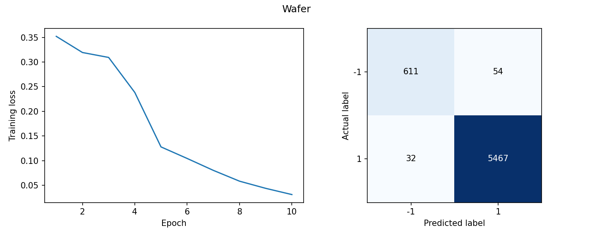
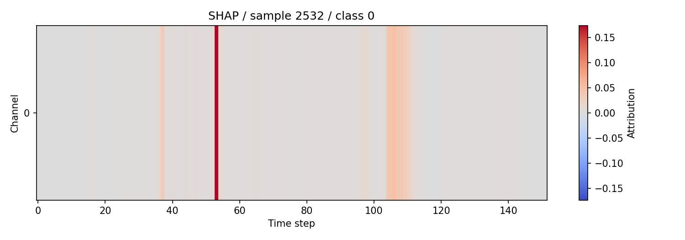

# Time Series Explainability

Wafer 공정 신호와 FingerMovements EEG를 분류하고, 예측에 영향을 준 구간을 LIME·SHAP·Integrated Gradients로 살펴본 프로젝트입니다.
설명가능한 기계학습 수업의 팀 과제에서 시작했습니다.

## 데이터

[UCR/UEA 데이터셋](data/README.md)의 `.ts` 파일을 사용합니다.
입력을 `(샘플, 시간, 채널)`로 맞추고, 학습 데이터의 채널별 평균과 표준편차로 정규화합니다.
모델은 positional encoding과 Transformer encoder, 시간축 평균 풀링으로 구성했습니다.

## 실행

검증 환경은 Python 3.13.2, CPU입니다. 패키지 버전은 `requirements.txt`에 기록했습니다.

```bash
python -m venv .venv
# Windows: .venv\Scripts\activate
# macOS/Linux: source .venv/bin/activate
python -m pip install -r requirements.txt
python src/train_explain.py --dataset both --epochs 10 --explanations all
```

데이터를 다른 곳에 두었다면 `--data-dir`로 지정합니다. 그래프와 지표는 `results/current/데이터셋명/`에 저장됩니다.
`--explanations none`으로 분류 학습만 실행할 수도 있습니다.

## 결과

시간·변수축과 설명 입력을 수정한 뒤 seed 42, 10 epoch로 다시 실행했습니다.
평가에는 제공된 시험셋을 사용했고, epoch나 모델을 시험 성능으로 선택하지 않았습니다.

| 데이터셋 | Accuracy | Macro F1 |
|---|---:|---:|
| Wafer | 0.9860 | 0.9632 |
| FingerMovements | 0.4600 | 0.4545 |





Wafer에서는 분류가 잘 됐지만 FingerMovements에서는 클래스 구분이 충분하지 않았습니다.
설명 그림은 선택한 예측의 기여도를 보여 주며, 그 자체로 분류 성능이나 인과관계를 검증하지는 않습니다.
클래스별 지표와 설명 샘플은 [결과 폴더](results/current/)에서 확인할 수 있습니다.
이전 과제 기록과 이번 수정 사항은 [실험 메모](docs/experiment-notes.md)에 정리했습니다.
